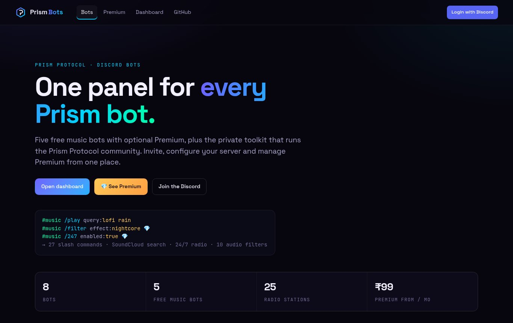
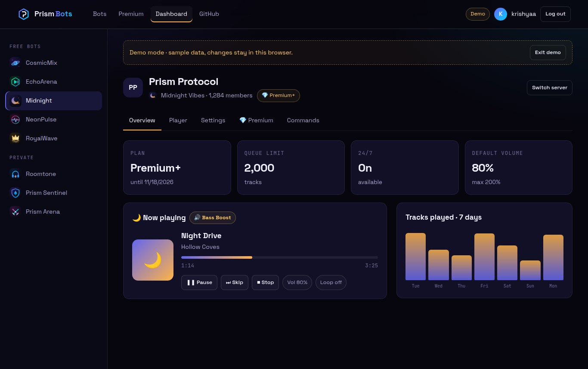
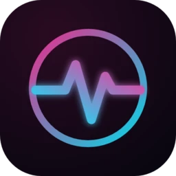
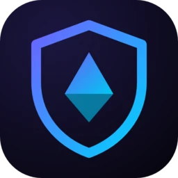
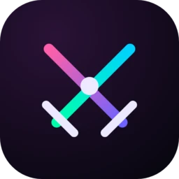

<div align="center">


[](https://krishyaa06.github.io/prism-bots-panel/)
[](https://krishyaa06.github.io/prism-bots-panel/#/premium)
[](https://dc.gg/prismprotocol)

</div>


A static web dashboard for all eight Prism Protocol bots. Invite the bots, compare plans, buy and redeem Premium, and manage server settings after logging in with Discord. No build step, no server: plain HTML, CSS and JavaScript on GitHub Pages.

<p align="center"></p>
<p align="center"></p>

## 🤖 Bots

| Bot | Type | Repo |
| --- | --- | --- |
|  CosmicMix DJ | Free music · 💎 Premium | [cosmicmix-dj-bot](https://github.com/krishyaa06/cosmicmix-dj-bot) |
|  EchoArena Player | Free music · 💎 Premium | [echoarena-player](https://github.com/krishyaa06/echoarena-player) |
|  Midnight Vibes | Free music · 💎 Premium | [midnight-vibes-bot](https://github.com/krishyaa06/midnight-vibes-bot) |
|  NeonPulse | Free music · 💎 Premium | [neonpulse-music-bot](https://github.com/krishyaa06/neonpulse-music-bot) |
|  RoyalWave DJ | Free music · 💎 Premium | [royalwave-dj-bot](https://github.com/krishyaa06/royalwave-dj-bot) |
|  Roomtone | Private · Prism Protocol | [roomtone-discord-music-bot](https://github.com/krishyaa06/roomtone-discord-music-bot) |
|  Prism Sentinel | Private · Prism Protocol | [prism-sentinel](https://github.com/krishyaa06/prism-sentinel) |
|  Prism Arena | Private · Prism Protocol | [prism-arena](https://github.com/krishyaa06/prism-arena) |

## ✨ What it does

- **Bot pages** with commands, radio stations and invite links
- **Premium page** with Free / Premium / Premium+ / Prism Pass plans, monthly or yearly
- **Dashboard**: Discord login, server picker, live player, settings, Premium redeem, stats
- **Demo mode** so anyone can try the dashboard with sample data
- Works on phones, keyboard friendly, respects reduced motion

## ⚙️ Setup

Everything lives in [`js/config.js`](js/config.js). Nothing in it is secret.

1. **Login:** create a Discord application for the panel, copy its ID into `oauthClientId`, and add `https://krishyaa06.github.io/prism-bots-panel/` under OAuth2 → Redirects.
2. **Invite buttons:** set each bot's `clientId` (its Application ID).
3. **Live data:** start a bot with `PANEL_API_PORT`, put it behind HTTPS and set its `apiUrl`. Each bot README has a "Web dashboard" section.
4. **Payments:** paste checkout links (Razorpay payment page, UPI, Ko-fi…) into `payments`. If empty, buyers are sent to the Discord server to open a ticket. After payment, create a key with `/genkey` and send it to the buyer.

## 🔒 How login works

The panel uses Discord's implicit OAuth2 flow with the `identify guilds` scope. The access token stays in the browser tab (session storage) and is only sent to the bot's own API, which checks **Manage Server** on every request.

## 🧑‍💻 Run locally

```bash
python3 -m http.server 8080
# open http://localhost:8080
```


<div align="center">

Built by [Soumya Bhandare](https://github.com/krishyaa06) · [Prism Protocol](https://dc.gg/prismprotocol) · MIT License

</div>
